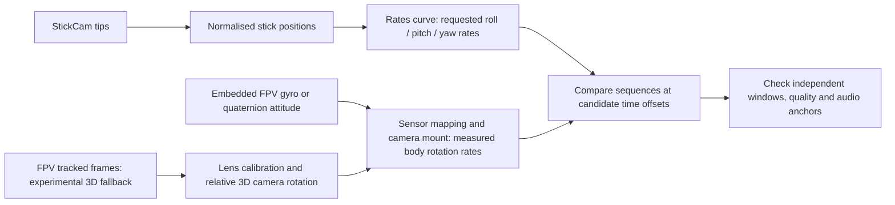

# Freestyle motion matching

Status: embedded FPV telemetry is now integrated into matching and review. Camera gyro rates, or local angular rates derived from fused quaternion attitude, are transformed using an explicit sensor mapping and camera uptilt. Visual fallback now includes experimental relative camera rotation from FOV-based viewing rays / essential pose with explicit projection and mount correction. Full measured lens calibration, source-adjacent high-rate tracking, world gravity and throttle dynamics remain planned and unvalidated.

## Intended footage

Fast acro/rate-mode FPV freestyle, including inverted flight, full rolls and flips, combined rotations, dives, throttle cuts, power loops and flights close to obstacles. The existing 10–40-pair batch, caching and bounded-memory requirements still apply.

Assume a rigid FPV camera and ordinary positive-thrust flight initially. Angle/horizon modes, FPV angle mix, reversed-thrust/3D mode, moving camera mounts and electronic stabilisation require explicit handling. These assumptions must be recorded with results rather than silently inferred from the image.

## Embedded telemetry and the two camera roles

Prefer supported embedded FPV motion using `telemetry-parser` (the parser used by Gyroflow). Preserve its source timing; distinguish native gyro from rates derived from fused attitude. A DJI sample in this session (`DJI_0003.MP4`) contains `djmd`/`dbgi` streams and decoded quaternions, with no raw gyro samples. Another (`DJIG0407.mp4`) exposes only a video stream. Availability depends on the camera and recording settings, so automatic mode falls back to visual motion; embedded-only mode reports unsupported clips.

Use local quaternion differences on SO(3), not Euler-angle differences, to measure 3D rotation across inversion and full revolutions. Reject invalid samples and timestamp gaps. Cache native telemetry independently of camera mount settings. Transform sensor rates into drone forward/right/down axes with a proper signed axis permutation, then camera uptilt; resample with quality weighting and smoothing before reducing rate. Compare roll/pitch/yaw stick positions or rates-derived requests against measured body rates. The gyro path does not substitute stick derivatives for rate commands. The existing stick/image polarity sign handling remains visible in axis details; no arbitrary axis swaps are fitted per candidate.

The default mapping `zXy` assumes Gyroflow camera axes: right/up/backwards. It maps roll = −Z, pitch = X, yaw = −Y before mount correction. Zero uptilt is an explicit initial assumption, not a detected mount angle. Users must confirm camera axes, uptilt and any sensor-to-video time shift. Profiles currently apply to the whole session; use separate sessions for different mounts. This path is implemented but needs labelled freestyle evaluation before claiming reliable or frame-accurate matching. Its motion-source and mount settings are recorded in results. Existing results need another analysis run to use it.

StickCam gyro belongs to camera stabilisation, not the pilot-control fingerprint. Detected tips supply roll/pitch/yaw/throttle; the observed radio outline anchors centring and levelling. The review worker follows the outline and proposes a crop that fits all four visible shell corners with a margin. Browser preview smooths centre/roll/zoom, permits immediate zoom-out to keep the tracked radio visible, and returns to the full source frame when the outline is lost. It cannot restore parts outside the recorded frame.

Optional StickCam camera gyro only predicts optical-axis rotation over gaps of at most 0.3 seconds after strong agreement with trusted outline increments (correlation ≥0.75, near-unit scale, at least 30 increments). It holds the last centre during that short prediction and does not infer radio translation or 3D perspective from gyro. If agreement fails, gyro assistance is disabled. This is a review preview, not an exported stabilised video or a replacement for gimbal tracking.

The Motion comparison section plots FPV body rates, sensor rates or available quaternion components above StickCam positions/requested rates and throttle. It shares a timeline, zoom/pan, cursor, signal toggles and an exploratory offset. Trace envelopes preserve peaks and invalid intervals; only one extraction worker runs with at most two pending comparisons. Individual clip extraction and telemetry are cached. Chart offsets do not silently change saved video alignment.

## What the current code does

`motion/lucas_kanade.py` tracks forward/backward-consistent features at the selected sampling rate. `motion/visual_rotation.py` turns pixels into viewing rays using recorded horizontal FOV and a rectilinear/equidistant approximation. A robust rotation-only fit handles low-parallax intervals; essential-matrix recovery handles translation with cheirality, distributed-support and planar-degeneracy checks. Unsupported intervals have zero quality. SO(3) rotation vectors and elapsed time give camera angular velocity, inverted from scene motion, then camera uptilt maps it into body Roll/Pitch/Yaw. The fingerprint retains 2D affine flow as separate diagnostics.

This is experimental, with FOV-based geometry rather than calibrated intrinsics/distortion. The initial 110° is an explicit approximation. Visual rates are not embedded gyro, absolute attitude or gravity. Estimate accuracy, polarity, degeneracy rejection and timing require known-gyro evaluation. Sampling still occurs before tracking, so rapid motion between sparse samples can be lost; no interpolation restores it.

`matching/correlation.py` compares corresponding body axes and rates-derived stick commands when available, rather than equating horizontal/vertical image flow with yaw/pitch. Legacy 2D review data retains its original labels. Radio Mode 1–4 assignments are explicit; Mode 2 remains the default. Cached canonical/physical observations are remapped without rescanning. Throttle remains normalized pilot input and does not contribute as a rotation axis.

## Primary fingerprint: rotation in drone axes

In acro/rate mode, roll/pitch/yaw stick position requests angular velocity around the drone's body axes. An inverted drone can have centred sticks and approximately zero angular velocity while remaining inverted. Therefore primary matching should compare commanded and measured body rotation rates, rather than absolute tilt or movement upward/downward in the image.

The proposed path is:

Visual 3D implementation and remaining requirements:

1. Decode adjacent source frames with presentation timestamps at a reduced spatial resolution. Estimate motion before reducing the fingerprint rate. Adapt tracking/keypoint matching for large rotations; reject blur, lost overlap, feature-poor views and inconsistent models. A 900 degrees/second turn spans 60 degrees between 15 Hz samples, versus 15 degrees at 60 fps. Higher source frame rate helps; interpolation or duplicated frames cannot recreate missing observations.
2. Use camera intrinsics, the correct lens distortion model and the actual video crop/resolution to turn pixels into viewing rays. Wide-angle/fisheye footage requires its appropriate model. A field-of-view approximation may support an experimental estimate with reduced confidence, but cannot be advertised as calibrated geometry.
3. The FOV-based experimental implementation estimates relative 3D camera rotation while accounting for translation/parallax. Evaluate robust essential-matrix pose recovery alongside a rotation-only fit for low-parallax intervals. Pure rotation, planar scenes and translation through nearby obstacles are degeneracies that need explicit checks. Require distributed feature support, consistent residuals and physically plausible motion. A large inlier count alone is insufficient.
4. Express increments using rotation matrices or quaternions; derive local angular velocity from the rotation increment and elapsed time. Do not differentiate wrapped Euler angles or bridge tracking gaps by integrating invented zero-motion samples. Verify the image/scene-versus-camera rotation sign convention on known rotations.
5. Transform camera angular velocity into drone body axes using the fixed mount orientation. Camera uptilt mixes axes even during upright flight. Store the camera mount transform per camera/clip profile; correct optical-flow units and physical coordinate conventions explicitly. A single mount-pitch parameter is a convenient UI option for a normally mounted camera, with a full transform available where needed.
6. Compare the measured body rates with rates derived from the tracked stick positions. Use signed axis sequences and several independent manoeuvre windows. Stick derivatives may be compared with measured angular acceleration as supplementary change evidence, rather than substituted indiscriminately for requested angular velocity. Unknown rates can use normalised signals with reduced amplitude claims.

Relative rotation remains meaningful when sky and ground swap places. Absolute gravity direction is unnecessary for this primary rotational fingerprint. Accumulating rotations may give relative attitude, but initial attitude and tracking gaps prevent treating it as a guaranteed world attitude estimate.

Camera configuration must remain consistent across candidate comparisons. Do not fit arbitrary axis swaps, sign changes, mount angles or per-axis delays independently at every lag just to maximise a wrong pair's score. If mount calibration is learned from a trusted match, constrain it to a physical rotation, retain its uncertainty and check it on held-out manoeuvres/clips.

## Gravity and throttle evidence

Use a separate, optional translation/dynamics path after the rotation fingerprint is validated. A conceptual world-frame model is:

`acceleration = gravity + (thrust / mass) × rotated body-up direction + aerodynamic effects`

For conventional positive thrust, adding throttle while inverted points thrust downwards in the world. During an upright climb, cutting throttle still allows upward momentum before gravity slows and reverses it. Near obstacles, large apparent image flow may mostly reflect scene depth. Consequently throttle cannot be equated with image vertical speed or inferred from sky position alone.

Throttle-to-thrust mapping also depends on the vehicle, battery, motor response and flight-controller behaviour. Predicting precise translation requires sufficient attitude, depth/scale and dynamics information. Ordinary monocular relative-pose translation has an unknown scale; a relative rotation estimate alone does not reveal a world gravity vector.

Possible supporting inputs are a known level reference frame, camera calibration, independently interpretable fused attitude/accelerometer metadata and optional flight-controller/Blackbox data. Gyro alone gives relative rotation with drift and an unknown initial gravity reference; an accelerating accelerometer measures specific force and cannot simply be treated as a down vector. A horizon/scene classifier can provide a fallible prior or a viewer overlay, not an authoritative gravity observation during trees, indoor flight, straight-up views or occlusion. Do not estimate FPV attitude solely by integrating the StickCam commands: using the candidate input as the visual measurement would make the match circular.

Initially treat throttle cuts, punches and acceleration changes as supporting events with explicit uncertainty. Enable gravity-aware throttle scoring only after independent gravity/attitude and translation-quality gates pass and its benefit is demonstrated on labelled footage. Failure of that path should leave rotational, audio and filename-clock evidence available.

## Timing and review

Flight-controller response, motor response, video processing and stabilisation can introduce delays. Motion correlation can confound recording offset with command-to-response latency. Do not subtract an assumed universal delay or claim frame accuracy from an interpolated correlation peak alone. Prefer independent shared-audio/recording anchors where available and report motion timing uncertainty.

Use several distinct manoeuvre windows to validate one common recording offset; check start/middle/end for drift. Expose requested versus measured axis plots, valid/invalid intervals, camera profile, estimator version, supporting manoeuvres and competing offsets. Absolute attitude/inversion overlays must indicate uncertainty. Audio and inferred filename clocks continue to help shortlist recordings, but dates are never a substitute for an independently supported start alignment.

Electronically stabilised or horizon-locked footage can suppress the very rotations being matched. Prefer original unstabilised footage or correctly interpreted gyro/stabilisation metadata. Unsupported stabilised clips should receive reduced/absent rotation evidence rather than apparently precise reconstructed motion.

## Delivery and evaluation gates

1. Evaluate the implemented embedded-telemetry path first, including vendor quaternion conventions, mount mapping, vibration, slow-motion timestamp scaling and gyro-to-video timing. Then add an optional experimental visual 3D rotation estimator and explicit camera/flight-mode settings; retain the current estimator as a documented baseline. Its fingerprints and caches must record intrinsics, crop, mount transform, source timing and estimator version. Decode/extract once per clip, cache compact signals, shortlist at a coarse comparison rate and refine likely pairs/windows.
2. Verify known 3D rotations, camera uptilt, inversion, complete revolutions, translation/parallax, timing gaps and different source frame rates. A pure translation scene must not become high-confidence stick rotation evidence.
3. Evaluate labelled real StickCam/FPV pairs and wrong combinations across roll flips, pitch flips, inverted hang time, combined-axis moves, throttle cuts, dives, close passes, blur and feature-poor sky views. Include different rates and camera mount angles. Independent Blackbox gyro/setpoint data can evaluate camera rotational accuracy. Do not use the same telemetry as both input and independent ground truth.
4. Report pair precision/recall, offset error against independent timing anchors, usable tracking coverage, axis errors and performance at the intended batch size. Establish acceptable accuracy before changing the default estimator or advertising freestyle reliability. Repetitive manoeuvres must remain ambiguous where evidence is insufficient.
5. Add world-attitude/gravity/throttle modelling only after its required observations and additional matching benefit are demonstrated. Reversed thrust and self-levelling modes need their own validated command models.

This rotation work is the next core matching priority. Radio catalogue expansion can help calibration, but it does not validate the physical FPV-versus-stick relationship.

## Technical references

- [Betaflight flight modes](https://betaflight.com/docs/wiki/guides/current/Modes): rate-mode versus angle/horizon command behaviour.
- [OpenCV camera calibration and relative pose](https://docs.opencv.org/4.13.0/d9/d0c/group__calib3d.html): camera geometry, distortion, relative rotation and translation scale ambiguity.
- [Lee, Leok and McClamroch: Geometric Tracking Control of a Quadrotor UAV on SE(3)](https://mleok.science/pdf/LeLeMc2010_quadrotor.pdf): body/world frames, thrust direction and gravity in translational dynamics.

- [Gyroflow DJI support](https://docs.gyroflow.xyz/app/getting-started/supported-cameras/dji): supported models/settings and fused quaternions rather than raw DJI IMU samples.
- [Telemetry parser Python interface](https://github.com/AdrianEddy/telemetry-parser/tree/master/bin/python-module): vendor parsing, units and normalised IMU data.
